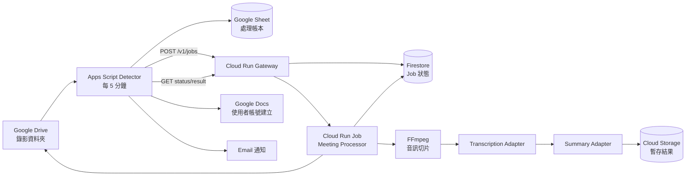
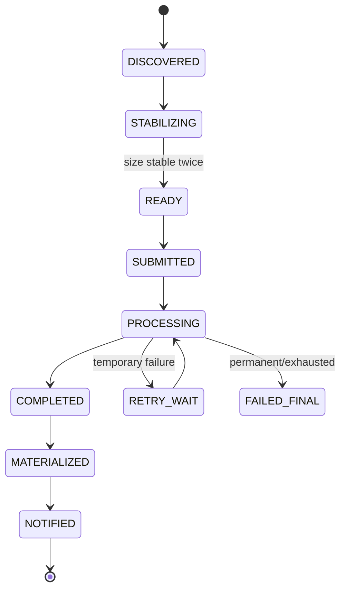

# Google Drive 自動會議紀錄：系統設計

狀態：初版設計  
日期：2026-08-20

## 1. 目標

當指定 Google Drive 資料夾出現已完成上傳的新錄影時，系統應在不持續消耗 AI token 的前提下，自動完成：

1. 偵測新錄影並避免重複處理。
2. 確認檔案已上傳完成。
3. 擷取音訊、產生逐字稿並整理會議紀錄。
4. 以使用者本人的 Google 帳號建立 Google Doc。
5. 將文件移入指定輸出資料夾並寄送完成通知。
6. 保留可查詢的處理狀態、錯誤與重試紀錄。

## 2. 核心決策

| 項目 | 決策 | 原因 |
|---|---|---|
| 新檔偵測 | Apps Script 每 5 分鐘輪詢 Drive metadata | 輪詢本身不呼叫 AI，不消耗 AI token；部署最簡單 |
| 長影音處理 | Cloud Run Job | 工作可執行到完成，適合下載、FFmpeg 與分段轉錄 |
| API 入口 | Cloud Run Service | 立即接受工作、提供狀態與結果查詢，不讓 Apps Script 等待長工作 |
| 去重 | Drive `fileId` 作為 idempotency key | 同一錄影重送也只建立一個工作 |
| 使用者帳號寫入 | Apps Script 建立 Google Doc | 避免服務帳號檔案所有權與 My Drive 儲存限制 |
| 處理狀態 | Google Sheet + Firestore | Sheet 讓使用者可見；Firestore 讓後端安全更新狀態 |
| AI 供應商 | OpenAI 優先；保留可插拔 adapter | 預設使用 OpenAI，日後仍可切換 Gemini 或 GX10；未明確啟用前不自動 fallback |

不採用「ChatGPT 每 5 分鐘直接查 Drive」：一天會產生 288 次模型工作；即使沒有新檔，仍會重複啟動模型與工具。Apps Script 只讀檔案 metadata，可把 AI 使用量降到「有新會議才產生」。

## 3. 架構



### 元件責任

#### Apps Script Detector

- 建立每 5 分鐘的 time-driven trigger。
- 只掃描指定資料夾，不掃描整個 Drive。
- 以 `LockService` 防止兩次 trigger 重疊。
- 對新檔做兩次大小穩定檢查。
- 寫入 Google Sheet 處理帳本。
- 將就緒檔案送到 Gateway。
- 查詢執行中工作的狀態。
- 下載完成結果、建立 Google Doc、移入輸出資料夾並寄信。

#### Cloud Run Gateway

- 驗證 Apps Script 的 HMAC 簽章與時間戳。
- 驗證 `fileId`、MIME type、檔案所在資料夾與大小。
- 以 `fileId` 原子式建立 Firestore job；重複請求回傳既有 job。
- 啟動 Cloud Run Job。
- 提供 status、result 與 retry API。
- 不下載或處理影音，因此可快速回應並 scale to zero。

#### Cloud Run Meeting Processor

- 使用唯讀權限下載指定 Drive 錄影。
- 用 FFmpeg 擷取音訊並依供應商限制切片。
- 執行轉錄、合併片段、修正時間軸。
- 以 structured output 產生會議紀錄。
- 將大型逐字稿與結果暫存到 Cloud Storage。
- 更新 Firestore job 狀態與進度。
- 在 `finally` 清理 container 暫存檔。

#### Google Sheet 處理帳本

建議欄位：

| 欄位 | 用途 |
|---|---|
| `file_id` | 唯一鍵 |
| `file_name` | 顯示與輸出命名 |
| `mime_type` | 僅接受允許的影音格式 |
| `size_bytes` | 判斷上傳是否穩定 |
| `modified_time` | 增量掃描與除錯 |
| `first_seen_at` | 首次發現時間 |
| `stable_count` | 連續大小相同次數 |
| `status` | 本地狀態機 |
| `job_id` | 後端工作 ID |
| `attempts` | 提交或重試次數 |
| `result_doc_url` | 最終 Google Doc |
| `notified_at` | 避免重複寄信 |
| `last_error` | 對使用者可讀的錯誤 |
| `updated_at` | 最後狀態更新時間 |

## 4. 端到端流程

### 4.1 新檔偵測

每次 trigger 執行以下順序：

1. 嘗試取得 script lock；若前一輪仍在執行，本輪直接結束。
2. 重新讀取帳本中 `DISCOVERED` / `STABILIZING` 的檔案，取得目前大小。
3. 若大小大於 0、連續兩輪相同，且檔案最後修改已超過安全緩衝時間，標記為 `READY`。
4. 以「上次掃描時間減去 10 分鐘」作為重疊視窗，搜尋新的影音檔。
5. 新檔先寫入帳本，不在第一次看見時立即提交。
6. 對 `READY` 檔案呼叫 `POST /v1/jobs`。
7. 對非終態工作查詢後端狀態。
8. 對 `COMPLETED` 工作取得結果並建立 Google Doc。
9. 更新掃描 watermark；只有本輪無未處理錯誤時才前進。

使用重疊視窗可避免 trigger 延遲、時鐘誤差或執行中斷造成漏檔；`fileId` 去重可避免因此重複處理。

### 4.2 後端處理

```text
QUEUED
  -> DOWNLOADING
  -> EXTRACTING_AUDIO
  -> TRANSCRIBING
  -> SUMMARIZING
  -> COMPLETED
```

任何階段失敗時：

- 暫時性錯誤進入 `RETRY_WAIT`，採 exponential backoff。
- 已重試至上限或不可恢復錯誤進入 `FAILED_FINAL`。
- 同一 `fileId` 永遠只允許一個 active execution。
- worker 開始前與寫入結果前都再次確認 job 尚未完成，確保 at-least-once 執行仍安全。

### 4.3 文件建立與通知

後端完成後，Apps Script：

1. 取得結構化結果。
2. 使用 `DocumentApp` 以使用者身分建立 Google Doc。
3. 套用標題、清單與待辦表格。
4. 將文件移入指定輸出資料夾。
5. 將 `result_doc_url` 寫回帳本。
6. 寄出一次完成通知。
7. 標記為 `NOTIFIED`。

若建立文件或寄信失敗，後端 AI 工作不需重跑；只重試 materialize / notify 階段。

## 5. 狀態機



## 6. API 草案

### `POST /v1/jobs`

```json
{
  "file_id": "1AbCdEf...",
  "file_name": "2026-08-20 產品會議.mp4",
  "mime_type": "video/mp4",
  "size_bytes": 1234567890,
  "modified_time": "2026-08-20T10:45:00Z",
  "source_folder_id": "folder-id"
}
```

回應：

```json
{
  "job_id": "job_01...",
  "state": "QUEUED",
  "duplicate": false
}
```

重送相同 `file_id` 時回傳既有 `job_id`，`duplicate` 為 `true`。

### `GET /v1/jobs/{job_id}`

```json
{
  "job_id": "job_01...",
  "state": "TRANSCRIBING",
  "progress_percent": 54,
  "attempt": 1,
  "updated_at": "2026-08-20T11:05:00Z",
  "error": null
}
```

### `GET /v1/jobs/{job_id}/result`

只在 `COMPLETED` 後開放，回傳會議 metadata、會議紀錄 JSON 與逐字稿 artifact reference。

### `POST /v1/jobs/{job_id}/retry`

只允許對 `FAILED_FINAL` 工作手動重試；保留原始錯誤與 attempt history。

## 7. 會議紀錄資料格式

AI 必須先輸出可驗證的 JSON，再由 Apps Script 排版，不直接相信任意 HTML：

```json
{
  "title": "產品週會",
  "meeting_date": "2026-08-20",
  "participants": [],
  "executive_summary": "...",
  "decisions": ["..."],
  "action_items": [
    {
      "task": "...",
      "owner": null,
      "due_date": null,
      "evidence": "00:32:10"
    }
  ],
  "discussion_topics": [
    {
      "topic": "...",
      "summary": "..."
    }
  ],
  "open_questions": ["..."],
  "transcript_language": "zh-TW",
  "warnings": []
}
```

規則：

- 沒有明講的負責人或期限必須輸出 `null`，不可猜測。
- 決議與待辦最好附時間戳 evidence。
- 不確定的人名保留轉錄文字並加入 `warnings`。
- 原始逐字稿與 AI 整理結果分開保存。

## 8. AI 與音訊處理介面

後端不要把模型名稱寫死：

```text
Transcriber.transcribe(audio_parts, language_hint) -> TranscriptSegment[]
Summarizer.summarize(transcript, meeting_metadata) -> MeetingMinutes
```

預設環境設定：

```text
AI_PROVIDER=openai
AI_FALLBACK_ENABLED=false
TRANSCRIPTION_PROVIDER=openai
TRANSCRIPTION_MODEL=gpt-4o-transcribe-diarize
TRANSCRIPTION_LANGUAGE=zh
SUMMARY_PROVIDER=openai
SUMMARY_MODEL=gpt-5.6-luna
SUMMARY_REASONING_EFFORT=low
SUMMARY_RESPONSE_FORMAT=json_schema
OPENAI_BASE_URL=https://api.openai.com/v1
OPENAI_STORE=false
```

可用路徑：

- OpenAI（預設）：`gpt-4o-transcribe-diarize` 負責說話者分離轉錄，`gpt-5.6-luna` 透過 Responses API 的 JSON Schema structured output 產生會議紀錄。
- Gemini：可重用現有 `offscreen.js` 的 File API 與 `background.js` prompt 概念，但預設不 fallback。
- GX10：沿用現有 `/meeting-llm/api/jobs` 非同步排隊介面做摘要；轉錄可維持雲端或另接本機模型。

如果實測顯示摘要品質不足，第一個升級選項是把 `SUMMARY_MODEL` 改為 `gpt-5.6-terra`；其餘介面與資料格式不變。真正的 `OPENAI_API_KEY` 只存 Cloud Secret Manager，不放在 Apps Script、Google Sheet、Chrome Extension 或 Git。

若錄影旁已有 `.vtt`、Meet 逐字稿或擴充功能 CC 匯出，優先採用文字來源，可省下音訊轉錄成本。

## 9. 安全設計

- Apps Script secret 存 `ScriptProperties`；Cloud secret 存 Secret Manager。
- Gateway 對每個請求驗證 `X-Meeting-Timestamp`、`X-Meeting-Nonce`、`X-Meeting-Signature`。
- HMAC canonical input 包含 method、path、timestamp、nonce 與 body SHA-256。
- 拒絕超過 5 分鐘的 timestamp，nonce 短期去重，降低 replay 風險。
- Gateway 必須確認檔案位於設定的來源資料夾，而非只相信呼叫端傳入的 folder ID。
- Worker Drive 權限只需讀取來源錄影；Google Doc 由 Apps Script 建立。
- 不在 log 中記錄 API key、完整逐字稿、簽章或錄影下載內容。
- Cloud Storage artifact 設定 lifecycle，例如成功 30 天後自動刪除；最終 Google Doc 依使用者 Drive 保留政策管理。

## 10. Token、配額與成本控制

- 5 分鐘 Drive 掃描：0 AI token。
- 無新錄影：不啟動 Cloud Run Job，不呼叫 AI。
- 有新錄影：只消耗該會議的轉錄與摘要費用。
- Gateway 設定 minimum instances = 0。
- Apps Script 每輪只查來源資料夾與非終態帳本列。
- 摘要 prompt 只傳必要逐字稿與格式規則，不附整段歷史對話。
- 可設定工作時段，例如 07:00–23:00，進一步減少 Drive API 呼叫。
- Google API、Apps Script、模型和 Cloud Run 的配額／價格應以部署時帳號與區域為準。

## 11. 失敗處理

| 情況 | 行為 |
|---|---|
| Trigger 重疊 | 無法取得 lock 的執行立即退出 |
| 檔案仍在上傳 | 留在 `STABILIZING`，下次再檢查 |
| 相同檔案重送 | Gateway 回傳既有 job，不重跑 |
| Drive 暫時無法下載 | exponential backoff 後重試 |
| 轉錄單一分片失敗 | 只重試該分片 |
| 摘要格式驗證失敗 | 使用修復 prompt 重試一次，仍失敗則保留逐字稿 |
| Google Doc 建立失敗 | 下輪只重試文件建立，不重跑 AI |
| 寄信失敗 | 保留文件 URL，下輪只重試通知 |
| 永久失敗 | Sheet 顯示錯誤並寄一次失敗通知 |

## 12. 建議專案結構

```text
auto-meeting-minutes/
├─ apps-script/
│  ├─ Code.gs
│  ├─ Config.gs
│  ├─ DriveScanner.gs
│  ├─ JobClient.gs
│  ├─ DocumentWriter.gs
│  └─ appsscript.json
├─ services/
│  ├─ gateway/
│  │  ├─ app/
│  │  ├─ tests/
│  │  └─ Dockerfile
│  └─ processor/
│     ├─ app/
│     ├─ tests/
│     └─ Dockerfile
├─ infra/
│  └─ terraform/
├─ docs/
│  └─ drive-automation-design.md
└─ 現有 Chrome Extension 檔案
```

現有 Chrome Extension 保持可獨立使用；Drive 自動化是另一條輸入路徑，兩者共用會議紀錄 JSON schema 與摘要 prompt。

## 13. 分階段實作

### Phase 1：零-token 偵測 MVP

- 建立 Apps Script、設定表與處理帳本。
- 實作 5 分鐘 trigger、lock、重疊視窗、檔案穩定判斷與去重。
- 先以 mock Gateway 驗證「每支錄影只提交一次」。

完成條件：放入三個測試檔並模擬重複 trigger，帳本只產生三個唯一工作。

### Phase 2：Gateway 與狀態機

- 建立 Cloud Run Gateway、Firestore job 與 HMAC 驗證。
- 建立 mock Cloud Run Job，回傳固定會議紀錄 JSON。
- Apps Script 可完成 status polling、Google Doc 建立與通知。

完成條件：不使用 AI，也能跑通 Drive → Job → Google Doc 全流程。

### Phase 3：真實影音與 AI

- 加入 Drive 下載、FFmpeg、分片轉錄與摘要 adapter。
- 加入逐字稿、時間戳、structured output 驗證與 artifacts lifecycle。
- 先用一支 5–10 分鐘錄影，再測 1–3 小時長錄影。

### Phase 4：可靠度與營運

- 加入 retry、失敗通知、手動重試、Cloud Logging 與成本告警。
- 驗證中途 crash、重複請求、API timeout、檔案刪除等情境。
- 視實際會議量決定是否加入嚴格的單工 queue。

## 14. 實作前需要的設定

1. 錄影來源資料夾 ID。
2. Google Doc 輸出資料夾 ID。
3. Google 帳號類型：個人 Gmail 或 Google Workspace。
4. AI 路徑已設定為 OpenAI；需要建立專用 OpenAI API project 與 API key。
5. 是否需要完整逐字稿。
6. 完成／失敗通知收件人。
7. 錄影通常長度、每週場次與語言。

## 15. 官方技術依據

- [Apps Script installable time-driven triggers](https://developers.google.com/apps-script/guides/triggers/installable)
- [Apps Script Drive service](https://developers.google.com/apps-script/reference/drive)
- [Apps Script quotas](https://developers.google.com/apps-script/guides/services/quotas)
- [Cloud Run services and jobs](https://docs.cloud.google.com/run/docs/overview/what-is-cloud-run)
- [Cloud Tasks with Cloud Run](https://docs.cloud.google.com/run/docs/triggering/using-tasks)
- [Google Drive shared drives and service accounts](https://developers.google.com/workspace/drive/api/guides/about-shareddrives)
- [ChatGPT scheduled tasks](https://learn.chatgpt.com/docs/automations)
- [OpenAI GPT-4o Transcribe Diarize](https://developers.openai.com/api/docs/models/gpt-4o-transcribe-diarize)
- [OpenAI GPT-5.6 Luna](https://developers.openai.com/api/docs/models/gpt-5.6-luna)
- [OpenAI Responses structured outputs](https://developers.openai.com/api/reference/typescript/resources/beta/subresources/responses/methods/create)

OpenAI 的具體操作步驟與 secret 放置方式請見 [OpenAI 優先設定](openai-setup.md)。
