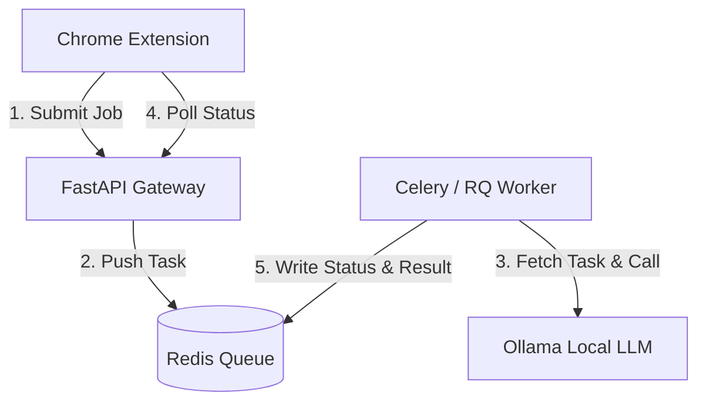

# GX10 Local LLM API Gateway & Queue Server Implementation Plan

This plan defines the architecture, API protocols, and integration workflow for deploying a local LLM gateway on the **ASUS Ascent GX10** using Docker. It ensures robust multi-user queuing, progress updates, remaining time estimations, error handling, and performance logging.

---

## 1. System Architecture (GX10 Server Side)

The server on the GX10 will be managed as a multi-container stack via **Docker Compose** to handle concurrency and asynchronous task execution:



### Stack Components (Docker Compose)
1.  **FastAPI Gateway (Python)**: Light web server exposing endpoints to the extension, handling request validation, and managing job IDs.
2.  **Redis**: Serves as the message broker for the task queue and temporary storage for job statuses.
3.  **Celery (or Python RQ) Worker**: Processes summarization tasks sequentially (concurrency=1 to prevent GPU VRAM overload).
4.  **Ollama**: Local inference server running Llama 3.1 70B or Qwen 2.5 72B.

---

## 2. API Endpoints Specification

The Gateway API will expose two main endpoints for the extension:

### A. Submit Summarization Job
*   **Path**: `POST /meeting-llm/api/jobs`
*   **Request Body**:
    ```json
    {
      "title": "Meeting Title",
      "prompt": "AI prompt template...",
      "transcript": "[華珍 - 10:00]: Hello..."
    }
    ```
*   **Response (202 Accepted)**:
    ```json
    {
      "job_id": "job_1782987123",
      "status": "queued",
      "queue_position": 2,
      "estimated_wait_seconds": 90
    }
    ```

### B. Query Job Status
*   **Path**: `GET /meeting-llm/api/jobs/{job_id}`
*   **Response (200 OK)**:
    *   *Case 1: Queued*
        ```json
        {
          "status": "queued",
          "queue_position": 1,
          "estimated_wait_seconds": 45
        }
        ```
    *   *Case 2: Processing*
        ```json
        {
          "status": "processing",
          "progress_percent": 45,
          "estimated_remaining_seconds": 25
        }
        ```
    *   *Case 3: Completed*
        ```json
        {
          "status": "completed",
          "result": "=== [會議紀錄] ===\n...",
          "ai_duration_seconds": 32.4
        }
        ```
    *   *Case 4: Failed*
        ```json
        {
          "status": "failed",
          "error": "Ollama service timeout or out of VRAM."
        }
        ```

---

## 3. Extension Enhancements (Auto Meeting Minutes Side)

To support this gateway, the Chrome Extension needs the following updates:

### A. Settings UI
*   Add a new option in the "AI 來源類型" (AI Source Type) dropdown: **「自訂閘道器 (非同步排隊)」** (Custom Gateway - Async Queue).
*   When selected, display URL configuration pointing to the FastAPI Gateway.

### B. Asynchronous Polling Logic in `popup.js` & `background.js`
*   Instead of waiting for a single HTTP response (which can time out), the extension will send a `POST` request to create a job, receive the `job_id`, and poll `GET /api/jobs/{job_id}` every **3 seconds**.
*   **UI Status Updates**: The loading spinner view will dynamically display:
    *   `排隊中... 您是第 N 位 (預估等待 X 秒)`
    *   `AI 整理中... 預估剩餘 Y 秒`
*   **Error Feedback**: If status returns `failed`, display the exact error message and unlock the retry button.
*   **AI Duration Logging**: When status returns `completed`, save `"ai_duration_seconds"` into the session record and display it in the history workspace (e.g., `⚡ AI 整理耗時：32.4 秒`).

---

## 4. Key Implementation Details for the API code

For the other instance of me on GX10 to implement:
1.  **Queue Position Calculation**: Calculated as the number of active tasks in the Redis queue ahead of the current job.
2.  **Wait Time Estimation**: 
    *   `estimated_wait_seconds` = `(position) * Average_Inference_Time` (e.g., default to 45s per job).
    *   `estimated_remaining_seconds` = Dynamic estimation based on prompt length (e.g., word count / processing speed).
3.  **Inference Tracking**: Wrap the Ollama API call with `time.perf_counter()` to record the exact duration of the local LLM generation.

---

## 5. Web Dashboard & Security (網頁監控看板與安全認證)

A secure, built-in dashboard will be served directly by the FastAPI server to monitor the server status, queues, and resources, isolated under the `/meeting-llm` path.

### A. Authentication Control (帳密安全管控)
*   **Protocol**: HTTP Basic Access Authentication (瀏覽器原生彈出帳密登入框，免去複雜的前端登入頁開發)。
*   **Configuration**: Credentials are set in the Docker environment:
    ```bash
    DASHBOARD_USERNAME=admin
    DASHBOARD_PASSWORD=gx10_secure_pass_2026
    ```
*   **Security Scope**: Applied to the `/meeting-llm/dashboard` HTML route and `/meeting-llm/api/monitor/*` metrics endpoints.

### B. Dashboard Features (網頁監控面板特色)
*   **Path**: `GET /meeting-llm/dashboard`
*   **Layout**: Single-Page Application (SPA) styled with Tailwind CSS, using Chart.js for real-time charts.
*   **Monitored Metrics**:
    1.  **System Resources (電腦硬體資源佔用)**:
        *   **CPU & RAM**: Monitored using Python `psutil` package.
        *   **GX10 GPU & VRAM**: Monitored using `nvidia-smi` queries or the `pynvml` library to track NVIDIA Blackwell GPU compute load and VRAM occupancy (critical for checking if Ollama runs out of memory).
    2.  **Job History (任務日誌與時間統計)**:
        *   **Job Receipt Times**: Log of when each job was pushed to Redis.
        *   **Process Duration**: Exact start time, completion time, and AI generation duration (`ai_duration_seconds`) for each meeting.
    3.  **Queue Metrics (排隊佇列)**:
        *   Total queued jobs.
        *   Status of the Celery task runner (Active/Idle).
